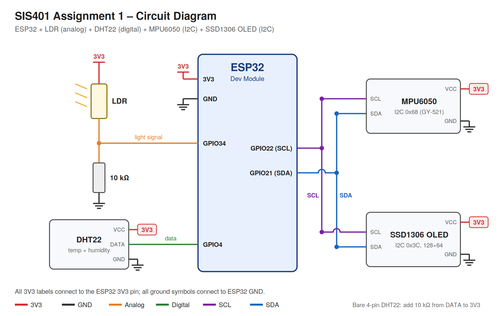
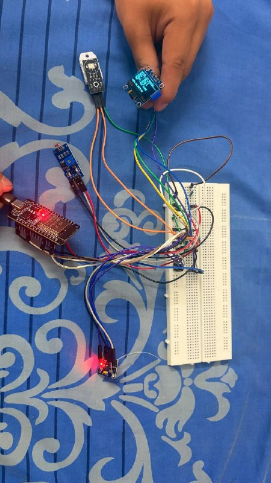
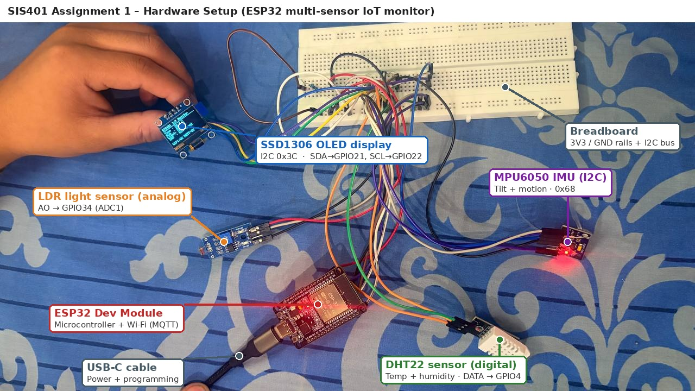

# SIS401 Programming Assignment 1 : Multi-Sensor IoT Monitoring System

**Student:** GROUP 1 · **Module:** SIS401 

An ESP32-based IoT monitor that reads **three different sensor types at the same time**, shows the readings live on an **OLED display**, and publishes them wirelessly over **MQTT** to a Mosquitto broker, where any subscriber can verify them.





---

## What the system does

- Measures **temperature and humidity** (DHT22), **ambient light** (LDR) and **tilt and motion** (MPU6050).
- Samples each sensor at its own rate using a non-blocking `millis()` scheduler, so all sensors, the display and MQTT run simultaneously.
- Shows every reading with labels and units on a 128×64 SSD1306 OLED, plus a Wi-Fi/MQTT status line.
- Publishes each reading to its own MQTT topic **and** a combined JSON message every 5 seconds.
- Reports its online/offline status using an MQTT **Last Will** message.
- Reconnects to Wi-Fi and MQTT automatically and keeps sensing while offline.
- Prints a startup diagnostic report (I2C scan, Wi-Fi visibility, sensor wiring hints) to the Serial Monitor.

## Sensors and components

| Component | Interface type | ESP32 pin(s) | Measures |
| --- | --- | --- | --- |
| LDR + 10 kΩ resistor | **Analog** (ADC1) | GPIO34 | Light level (%) |
| DHT22 | **Digital** single-wire | GPIO4 | Temperature (°C), humidity (%) |
| MPU6050 (GY-521) | **I2C** (0x68) | GPIO21 SDA, GPIO22 SCL | Acceleration, rotation, pitch/roll (°), motion state |
| SSD1306 OLED 128×64 | I2C (0x3C) | GPIO21 SDA, GPIO22 SCL | Local display |
| ESP32 Dev Module | – | – | Microcontroller with Wi-Fi |

**Why GPIO34 for the LDR?** It is on ADC1. ESP32 ADC2 pins stop working while Wi-Fi is active.

## Wiring

| Component pin | ESP32 pin |
| --- | --- |
| DHT22 VCC / DATA / GND | 3V3 / GPIO4 (D4) / GND |
| LDR leg 1 / leg 2 | 3V3 / GPIO34 |
| 10 kΩ resistor | GPIO34 to GND |
| MPU6050 VCC / GND / SCL / SDA | 3V3 / GND / GPIO22 / GPIO21 |
| OLED VCC / GND / SCL / SDA | 3V3 / GND / GPIO22 / GPIO21 |

Notes:
- A bare 4-pin DHT22 needs a 10 kΩ pull-up resistor from DATA to 3V3 (3-pin modules include one).
- The OLED and MPU6050 share the same I2C bus because they have different addresses.
- On the GY-521 board the pin order is VCC, GND, **SCL, SDA** – leave XDA, XCL, AD0 and INT unconnected.

Hardware photo: `images/hardware_photo.jpg` 



## Wireless protocol: MQTT

MQTT was chosen over BLE and HTTP REST because it is lightweight, uses publish/subscribe (any number of clients can receive the data), and supports a clear topic hierarchy and Last Will status.

| Topic | Payload example |
| --- | --- |
| `assignment1/sensors/light` | `72` |
| `assignment1/sensors/temperature` | `26.3` |
| `assignment1/sensors/humidity` | `61.2` |
| `assignment1/sensors/accel_x` | `-0.03` (m/s²) |
| `assignment1/sensors/accel_y` | `1.01` (m/s²) |
| `assignment1/sensors/accel_z` | `9.79` (m/s²) |
| `assignment1/sensors/all` | combined JSON (below) |
| `assignment1/status` | `online` / `offline` (retained, Last Will) |

```json
{"temperature":26.3,"humidity":61.2,"light":72,"light_raw":2950,
 "accel":{"x":0.12,"y":-0.20,"z":9.79},"gyro":{"x":0.4,"y":-0.3,"z":0.1},
 "pitch":-0.7,"roll":-1.2,"moving":false,"uptime_s":312}
```

---

## Setup and running

### 1. Install the Arduino IDE and ESP32 board support

1. Install the Arduino IDE from arduino.cc.
2. **File → Preferences → Additional boards manager URLs**, add:
   `https://espressif.github.io/arduino-esp32/package_esp32_index.json`
3. **Tools → Board → Boards Manager**, install **esp32** by Espressif Systems.
4. Select **Tools → Board → esp32 → ESP32 Dev Module**.

### 2. Install libraries

**Sketch → Include Library → Manage Libraries**, install:

- Adafruit SSD1306
- Adafruit GFX Library
- DHT sensor library (Adafruit) + Adafruit Unified Sensor
- PubSubClient (Nick O'Leary)

(No MPU6050 library is needed – the sketch reads the chip's registers directly so clone chips also work.)

### 3. Configure the sketch

Open `sis401_assignment1/sis401_assignment1.ino` and edit the settings block at the top:

```cpp
const char* WIFI_SSID      = "CST-HA";        
const char* WIFI_PASSWORD  = "Hostel@HA#";
const char* MQTT_BROKER    = "10.2.23.29";      
const int   MQTT_PORT      = 1883;
const char* MQTT_CLIENT_ID = "esp32-sis401-11";  
```

Find the broker computer's IP: macOS `ipconfig getifaddr en0` · Windows `ipconfig` · Linux `ip a`.

### 4. Start the Mosquitto broker

Install Mosquitto (macOS: `brew install mosquitto`). This repo includes `mosquitto.conf`:

```
listener 1883
allow_anonymous true
```

Run it from the repo folder:

```bash
mosquitto -c mosquitto.conf -v
```

If you see *Address already in use*, stop the background service first: `brew services stop mosquitto`.

### 5. Upload the firmware

1. Connect the ESP32 by USB and select the port under **Tools → Port**.
2. Click **Upload** (hold the **BOOT** button if it stays on "Connecting…").
3. Open **Serial Monitor** at **115200** baud and press **EN/RST**.

### 6. Verify the wireless data

In a second terminal:

```bash
mosquitto_sub -h localhost -t "assignment1/#" -v
```

Expected output (every 5 seconds):

```
assignment1/status online
assignment1/sensors/light 72
assignment1/sensors/temperature 26.3
assignment1/sensors/humidity 61.2
assignment1/sensors/accel_x -0.03
assignment1/sensors/accel_y 1.01
assignment1/sensors/accel_z 9.79
assignment1/sensors/all {"temperature":26.3, ...}
```

To prove all sensors run simultaneously: cover the LDR, tilt the board and breathe on the DHT22 – all values change in the same JSON message.

## Results

| Evidence | File |
| --- | --- |
| OLED showing all readings | `images/oled_display.jpg` |
| Serial Monitor startup report and readings | `images/serial_monitor.png` |
| MQTT subscriber receiving data | `images/mqtt_subscriber.png` |
| Hardware setup | `images/hardware_photo.jpg` |


## Troubleshooting

| Symptom | Fix |
| --- | --- |
| `OLED not found` | Check SDA→GPIO21, SCL→GPIO22 and power |
| OLED shows `IMU: not found` | Check MPU6050 soldering and SCL/SDA order; the sketch retries every 5 s |
| `DHT22 read failed` repeatedly | Check DATA→GPIO4, pin order, pull-up resistor, split breadboard rails |
| Wi-Fi never connects | Use a 2.4 GHz network; copy the exact name from the startup Wi-Fi scan |
| MQTT `state -2` | Wrong broker IP, broker not running, different network, or firewall blocking port 1883 |

## Repository structure

```
sis401-assignment1/
├── sis401_assignment1/
│   └── sis401_assignment1.ino   # firmware
├── images/
│   ├── circuit_diagram.png
│   └── hardware_photo.jpg
│   └── mqtt_subscriber.jpg
│   └── oled_display.png
│   └── serial_monitor.png
│   └── setup.png
├── mosquitto.conf               # broker config
├── README.md
├── REFLECTION.md
└── .gitignore
```
